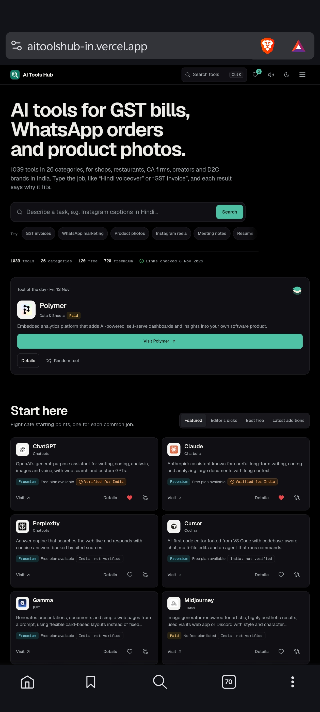
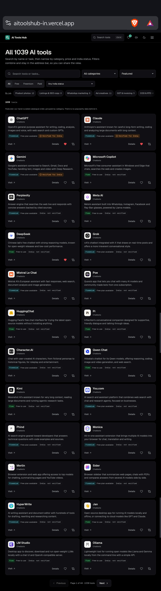
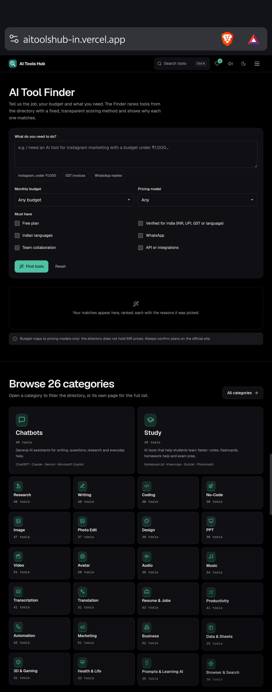
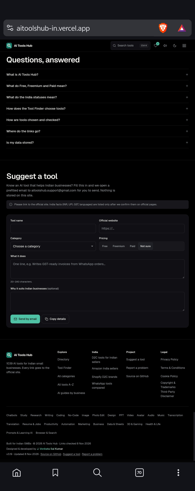
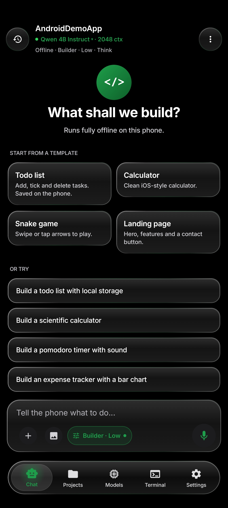
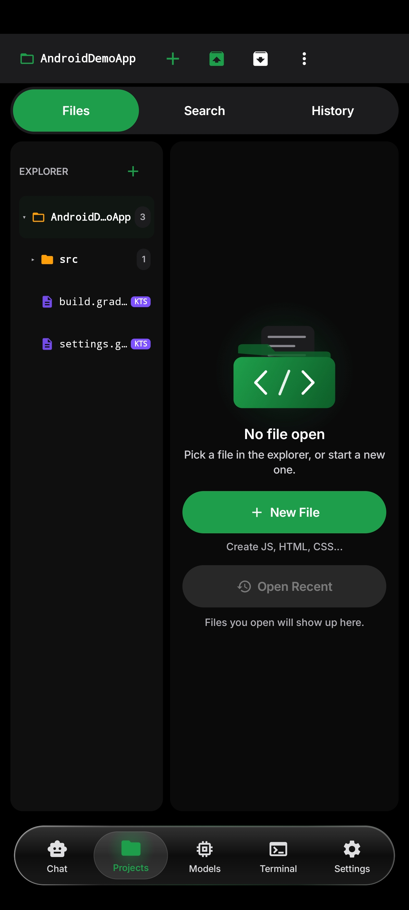
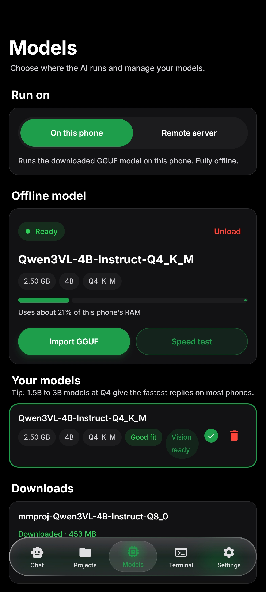
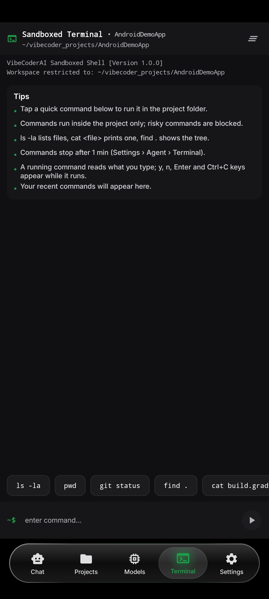
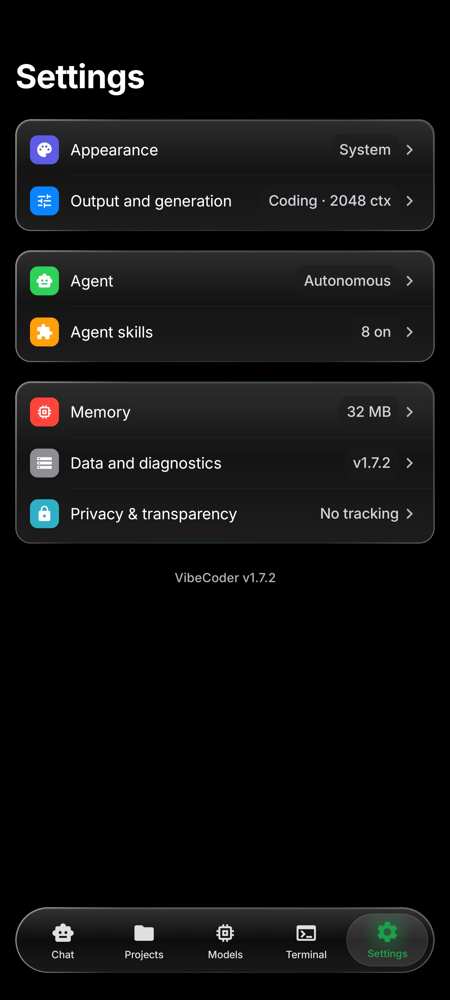

# Sai Kumar

Android developer. Building AI tools that run on phones.

I mostly work on Android and AI-related projects, with an interest in on-device models, offline-first apps, and making development more accessible.

---

## What I'm building

**AI Tools Hub** — A directory of 1,039 AI tools across 26 categories. Built to help Indian small businesses and creators discover useful AI tools without wasting time searching through multiple websites.

[Live website](https://aitoolshub-in.vercel.app/) · [Source code](https://github.com/kinggend/AI-TOOLS-HUB)

`JavaScript` · `HTML` · `CSS`

  
  &nbsp;&nbsp;
  

  
  &nbsp;&nbsp;
  

 

**VibeCoderAI** — An Android AI coding assistant that lets users write, edit, and test code directly on their phones.

[Source code](https://github.com/kinggend/VibeCoderAI)

It supports a **hybrid AI approach**:
- **Offline:** Powered by `llama.cpp` for local inference on low-resource devices (no server needed).
- **Online:** Users can add their own API keys (BYOK) to connect to remote models for heavier tasks.

`Kotlin` · `Jetpack Compose` · `C++` · `llama.cpp` · `Retrofit`

  
  &nbsp;&nbsp;
  
  &nbsp;&nbsp;
  

  
  &nbsp;&nbsp;
  

---

## Tech I use

Kotlin · JavaScript · C++ · HTML · CSS · Git

Android development · On-device AI · Remote APIs · Offline-first apps

---

## Currently working on

- Enhancing the API key (BYOK) user experience and adding more remote model support in VibeCoderAI.
- Improving local model performance and stability for low-end devices.
- Cleaning up AI Tools Hub and making it easier to navigate.
- Developing **Village Tractor Simulator**, a mobile game (Work in Progress).

---

## Links

[GitHub](https://github.com/kinggend) · [AI Tools Hub](https://aitoolshub-in.vercel.app/)
